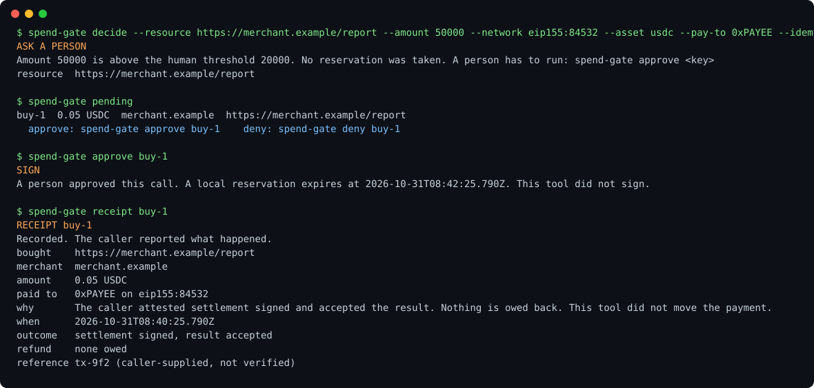

# spend-gate

An agent can ask to spend. Only a person can say yes (over MCP).
spend-gate sits in front of any paid call (x402 today): it checks budget, merchant, and recipient, parks big spends for a human, and writes a receipt you can read.
It never holds a key, never signs, and never moves value.



## Quickstart

```bash
npm install && npm run build && npx spend-gate init
```

`init` writes `allowHosts: []`, which refuses every call. Edit `spend-gate.json` and add the merchant you trust before anything can be approved:

```json
"allowHosts": ["merchant.example"]
```

Add it to your agent (Claude Code, Cursor, any MCP client):

```json
{ "mcpServers": { "spend-gate": { "command": "node", "args": ["/abs/path/to/spend-gate/dist/mcp.js"],
  "env": { "SPEND_GATE_CONFIG": "/abs/path/spend-gate.json" } } } }
```

The agent calls `spend_gate_decide` before it pays. Above your threshold it gets `ask_human`. You approve in another terminal:

```bash
npx spend-gate pending          # what is waiting
npx spend-gate approve buy-1    # or: deny buy-1
npx spend-gate receipt buy-1    # what was bought, why, refund status
```

The MCP server does not expose approve or deny, so an agent that only has the MCP tools cannot approve itself. This is not a sandbox: an agent with shell access can run `spend-gate approve` itself, or edit the ledger and config files. To keep the boundary, run the agent without shell access to the gate's config and ledger. Setting `SPEND_GATE_ALLOW_AGENT_APPROVAL=1` exposes approve and deny over MCP; only do that if you accept the agent approving its own spend.

## What it checks, in order

1. The challenge parses. Amounts are atomic integer strings (`"10000"`, not `0.01`). `exact` is the only scheme it prices. `upto` and `batch` are refused rather than guessed.
2. Network, asset, and `payTo`, when those lists are set in the config. An empty list here allows any value (unlike `allowHosts`).
3. Hostname allowlist. `merchant.example` is exact. `*.merchant.example` is a subdomain, not the apex. An empty list refuses every host.
4. Per-call ceiling.
5. Remaining budget. Open reservations count. A call that does not fit is refused, and the remainder stays unspent.
6. Human threshold. A call strictly above it returns `ask_human` and reserves nothing until `approve`.

`sign` writes a reservation. It is not a signature. Your own wallet signs after that, if you have one. Then `record` writes what happened.

## Receipts

| What the caller reports | Budget | Refund field |
| --- | --- | --- |
| `settlement: signed` or `simulated`, fulfilment accepted | spent | `none_owed` |
| `settlement: signed` or `simulated`, fulfilment rejected | spent | `not_refunded` |
| `settlement: unsent` | released, not spent | `not_applicable` |

`not_refunded` means the receipt stays. This tool does not reverse a payment, and an exact payment is not clawed back here. A `signed` receipt is the caller's attestation. The ledger is not a chain explorer.

Reservations expire. `decide`, `record`, `approve`, `deny`, and `expire` write the release. Until then, `ledger` already stops counting them.

## Config

`spend-gate init` writes `spend-gate.json` in the current directory. Amounts are strings of atomic units. With 6 decimals, `10000` is 0.01 of the token and `1000000` is 1.

```json
{
  "budgetAtomic": "1000000",
  "ceilingAtomic": "100000",
  "humanThresholdAtomic": "50000",
  "decimals": 6,
  "symbol": "USDC",
  "allowHosts": ["merchant.example"],
  "networks": ["eip155:84532"],
  "assets": [],
  "allowPayTo": [],
  "reservationTtlSeconds": 120,
  "ledgerPath": "ledger.jsonl"
}
```

Empty `networks`, `assets`, and `allowPayTo` allow any value — that is intentional fail-open, not a lock-down. An empty `allowHosts` is the opposite: it refuses every host. Pin `networks`, `assets`, and `allowPayTo` to the chain, token, and recipient you actually accept. Network strings are matched exactly and case-sensitively (`eip155:84532` ≠ `EIP155:84532`; a merchant that sends `base-sepolia` will not match `eip155:84532`). Asset and `payTo` matching is case-insensitive.

The ledger path is resolved relative to the config file. The config is read from `--config`, then `SPEND_GATE_CONFIG`, then `./spend-gate.json` if it exists, then `~/.config/spend-gate/spend-gate.json`.

## CLI

```bash
npm install
npm run build
npx spend-gate init
npx spend-gate decide \
  --resource https://merchant.example/search \
  --amount 10000 \
  --network eip155:84532 \
  --asset token-usdc-test \
  --pay-to payee-test \
  --idempotency-key job-1
npx spend-gate pending
npx spend-gate approve job-1
npx spend-gate record job-1 --fulfilment rejected --settlement simulated --reference local-1
npx spend-gate receipt job-1
npx spend-gate ledger
npx spend-gate probe https://merchant.example/search
```

`decide --challenge challenge.json` accepts an x402 v1 or v2 body (`accepts[]`, `amount` or `maxAmountRequired`) or a base64 `PAYMENT-REQUIRED` value. `--challenge -` reads stdin.

`probe` sends a GET with no payment header and does not follow redirects. It previews the decision. `--reserve` persists a reservation when the action is `sign`.

Exit `0` means sign, recorded, or released. Exit `2` means refuse. Exit `3` means a person has to approve. Exit `1` is a bad challenge, bad usage, or a failed fetch.

## Library

```ts
import { decide, loadPolicy, record } from "spend-gate";

const policy = loadPolicy("./spend-gate.json");
const decision = await decide({
  policy,
  input: challengeJson,
  idempotencyKey: "job-1",
});

if (decision.action === "sign") {
  // Sign with your own wallet. Then:
  await record({
    policy,
    idempotencyKey: decision.idempotencyKey,
    settlement: "signed",
    fulfilment: "accepted",
    reference: "your-transaction-id",
  });
}
```

`evaluate` is the same check without a reservation. `valueMovedByThisTool` is always `false`.

## MCP

The stdio server is `spend-gate-mcp`. Point `SPEND_GATE_CONFIG` at the config file.

```json
{
  "mcpServers": {
    "spend-gate": {
      "command": "spend-gate-mcp",
      "env": { "SPEND_GATE_CONFIG": "/absolute/path/spend-gate.json" }
    }
  }
}
```

Tools: `spend_gate_preview`, `spend_gate_decide`, `spend_gate_record`, `spend_gate_receipt`, `spend_gate_ledger`, `spend_gate_probe`. `spend_gate_approve` and `spend_gate_deny` are off unless `SPEND_GATE_ALLOW_AGENT_APPROVAL=1`.

A policy refusal is a normal tool result with `action: "refuse"`. It is not a transport error, and retrying it will not move the payment. `ask_human` is waiting for a person to run `spend-gate approve` or `deny`; call `spend_gate_decide` again with the same key afterwards.

## Development

```bash
npm test
npm run build
```

Node 20 or newer.
